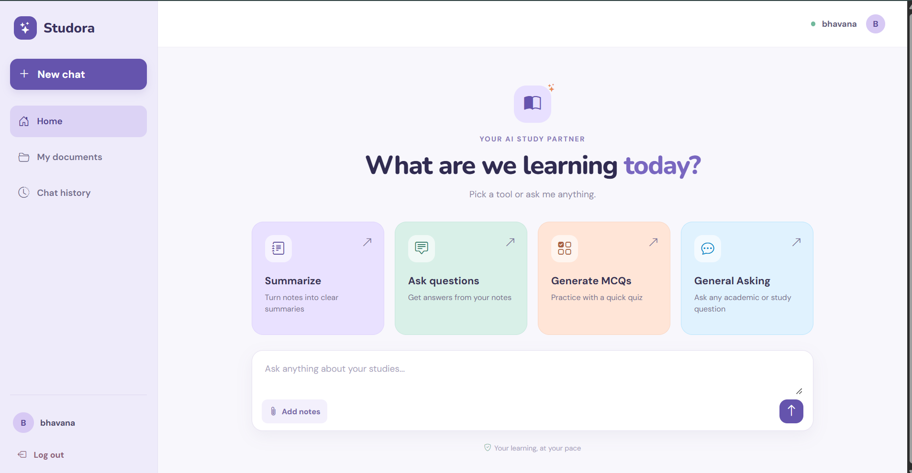

# STUDORA – Student AI Assistant

STUDORA is an AI-powered study assistant designed to help students interact with their study materials. Students can upload documents, ask questions, generate multiple-choice questions (MCQs), and summarize documents using Generative AI.

The project combines **Retrieval-Augmented Generation (RAG)** and **Agentic AI** to provide document-based question answering and intelligent study assistance.

## Features

- **Document Upload:** Upload study materials for AI-powered processing.
- **Document-based Q&A:** Ask questions and receive context-aware answers based on uploaded documents.
- **Semantic Search:** Retrieve relevant document chunks using ChromaDB.
- **Document Summarization:** Generate summaries of uploaded study materials.
- **MCQ Generation:** Generate multiple-choice questions with different difficulty levels.
- **Agentic AI:** LangGraph-based agent that selects and uses tools based on user requests.
- **Web Search:** Retrieve relevant information from the web.
- **Conversational Memory:** Maintain chat history and conversations.

## Tech Stack

**Frontend**
- React.js
- JavaScript
- Bootstrap
- HTML5
- CSS3

**Backend**
- Python
- Django
- Django REST Framework

**AI & Generative AI**
- Retrieval-Augmented Generation (RAG)
- OpenAI API
- LangGraph
- LangChain
- ChromaDB

**Document Processing**
- PyPDF

**Tools**
- Git and GitHub
- Postman
- VS Code

## System Workflow

1. Students upload their study documents through the React frontend.
2. Django REST Framework receives and processes the uploaded documents.
3. Text is extracted and divided into smaller chunks.
4. Document embeddings are stored in ChromaDB.
5. When a student asks a question, relevant chunks are retrieved using semantic search.
6. The retrieved context is passed to the OpenAI model to generate an answer.
7. The LangGraph agent can select appropriate tools such as document retrieval, web search, summarization, and MCQ generation.
8. The generated response is returned to the React frontend.

## Project Structure

```text
STUDORA/
│
├── backend/
│   ├── ai_engine/
│   ├── conversations/
│   ├── documents/
│   ├── manage.py
│   └── requirements.txt
│
├── frontend/
│   ├── public/
│   ├── src/
│   └── package.json
│
├── screenshots/
│
└── README.md
```

## Installation and Setup

### Prerequisites

- Python
- Node.js and npm
- OpenAI API Key

### Backend Setup

Clone the repository:

```bash
git clone https://github.com/YOUR-USERNAME/studora-student-ai-assistant.git
```

Navigate to the backend directory:

```bash
cd studora-student-ai-assistant/backend
```

Create a virtual environment:

```bash
python -m venv venv
```

Activate the virtual environment:

**Windows:**

```bash
venv\Scripts\activate
```

Install dependencies:

```bash
pip install -r requirements.txt
```

Create a `.env` file in the backend directory:

```env
OPENAI_API_KEY=your_openai_api_key
```

Run migrations:

```bash
python manage.py migrate
```

Start the Django server:

```bash
python manage.py runserver
```

### Frontend Setup

Open another terminal and navigate to the frontend directory:

```bash
cd frontend
```

Install dependencies:

```bash
npm install
```

Start the React development server:

```bash
npm run dev
```

Open the local URL displayed in the terminal.

## Screenshots

### Dashboard


### Document Upload


### Document-based Chat


### MCQ Generation


### Document Summarization


### Agentic AI


*Add your actual screenshots to the `screenshots` folder using the filenames shown above.*

## Environment Variables

| Variable | Description |
|---|---|
| OPENAI_API_KEY | OpenAI API key |

**Important:** Never upload your `.env` file or API keys to GitHub.

## Future Enhancements

- Improve AI agent tool orchestration.
- Support additional document formats.
- Enhance document source citations.
- Deploy the application to a cloud platform.

## Author

**Bhavana Bhageerathi**

B.Tech Graduate – Artificial Intelligence and Machine Learning